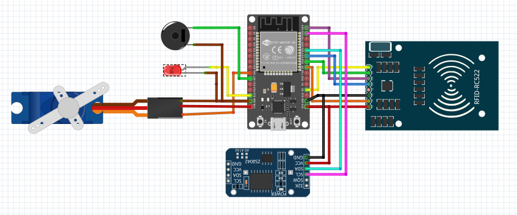
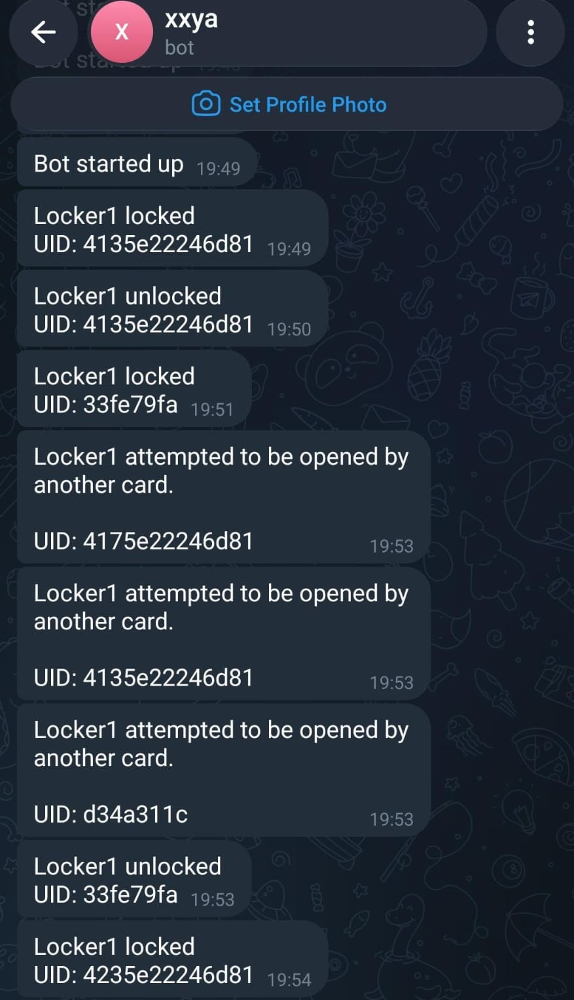

# ESP32 Smart Locker System

## Overview
Smart Locker System is a group project developed as part of Software Development Tools subject.

The system uses an ESP32 microcontroller, RFID-based identification, and a servo motor to manage locker access. Firebase Realtime Database (RTDB) stores UID information, timestamps, and locker status, while Telegram provides notifications for locker-related events.

The main objective is to prevent a locker that is currently use from being accessed by a different UID until the locker becomes available again.

# Key Features

1. RFID-Based Identification: Reads RFID card UIDs to identify access requests.
2. UID-Based Access Control: Prevents a different UID from accessing a locker while it is in use.
3. Firebase Realtime Database Integration: Stores UID information, timestamps, and locker status.
4. Telegram Notifications: Sends notifications related to card interactions, locker status changes, and rejected access attempts via chat bot.

## Hardware Components
1. Microcontroller: ESP32
2. RFID reader: Reads RFID card UIDs
3. RFID card/tag: Provides identification input
4. Micro servo SG-90: Operates the locker locking mechanism
5. Buzzer: Provides audible feedback when the locker is accessed by the same UID and alerts when different UID attempting to access
6. LED: Provides visual indication, whether the locker is available or not

## Database
Firebase Realtime Database stores information used to manage locker usage.

The recorded data includes:
1. UID: Identifies the RFID card associated with locker interaction
2. Timestamp: Records the time associated with an event
3. Locker Status: Indicates whether the locker is available for reuse or currently occupied

## Hardware Wiring
The wiring diagram illustrates the connections between the ESP32 microcontroller and the hardware components used in locker system.

## Telegram Notifications
The system integrates Telegram to provide notifications related to locker activities, including card interactions, locker status changes, and forced access attempts.

The following screenshots show the notification interface.

## My Contribution
Contributed to the development and integration of the ESP32-based smart locker system, with responsibilities including:
1. Firebase Integration: Configures Firebase Realtime Database (RTDB) to store RFID UID information, timestamps, and locker status
2. Hardware Integration: Collaborated with teammate to integrate and configure the servo motor, LED, and buzzer within the locker system
3. System Integration: Contributed connecting the database, hardware components, and existing Telegram notification code developed by teammate functionally as part of the overall system
